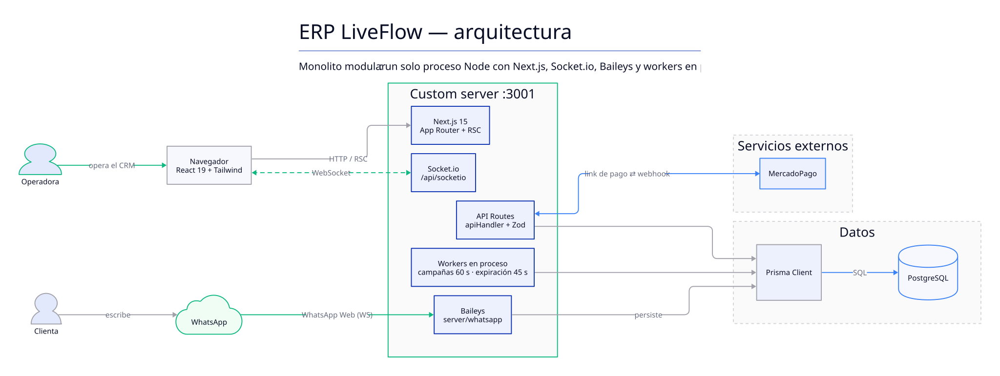

# LiveFlow CRM — Express Sales for Live Shopping & WhatsApp

[](https://nextjs.org/)
[](https://www.postgresql.org/)
[](https://socket.io/)
[](https://github.com/WhiskeySockets/Baileys)

---

## Vision General

**LiveFlow CRM** es una plataforma operativa disenada para transmisiones de **Live Shopping** (TikTok, Instagram, YouTube Live) integrada a WhatsApp para emitir **ordenes de cobro express al vuelo** sin depender de inventario estricto.



> Diagrama escrito a mano en `docs/diagramas/arquitectura.d2`. Regenerar con `npm run diagramas`.

---

## Stack Tecnologico

| Capa | Tecnología |
|------|-----------|
| Frontend | Next.js 16 (App Router + Turbopack), React 19, TypeScript 5.9 |
| Estilos | Tailwind CSS 4 (`@import "tailwindcss"` + config legacy vía `@config`) |
| Backend | Next.js API Routes + Express (custom server) |
| Base de datos | PostgreSQL + Prisma 6 |
| Validación | Zod 4 (esquemas compartidos en `src/lib/schemas.ts`) |
| Tiempo real | Socket.io (WebSocket) con eventos tipados |
| WhatsApp | Baileys (WhatsApp Web, sin Cloud API) |
| Pagos | MercadoPago + Transferencia bancaria directa |
| UI | Radix UI (Tabs), Base UI, lucide-react, sonner |
| Tipografía | SF Pro (Apple) / Inter (fallback cross-platform) |

---

## Requisitos Previos

- Node.js >= 20.9 (Next.js 16)
- PostgreSQL 14+
- npm (recomendado; el lockfile es `package-lock.json`)

---

## Instalacion

```bash
# 1. Clonar
git clone git@github.com:jjesusdev/erp-liveflow.git
cd erp-liveflow

# 2. Instalar dependencias
npm install

# 3. Configurar variables de entorno
cp .env.example .env
# Editar .env con tu DATABASE_URL

# 4. Crear schema de base de datos (desarrollo)
npm run db:push
# En producción, aplicar migraciones versionadas:
npm run db:deploy

# 5. (Opcional) Seed de datos demo (sólo entornos no productivos)
npm run db:seed

# 6. Iniciar en desarrollo (puerto 3001)
npm run dev
```

Abrir [http://localhost:3001](http://localhost:3001). El login demo está disponible por defecto fuera de producción; en producción requiere `ALLOW_DEMO_LOGIN=true` (no recomendado).

---

## Scripts Disponibles

| Script | Descripción |
|--------|-------------|
| `npm run dev` | Servidor de desarrollo (puerto 3001) |
| `npm run dev:fast` | Desarrollo sin WhatsApp ni workers |
| `npm run build` | Build de producción |
| `npm run start` | Servidor de producción |
| `npm run typecheck` | `tsc --noEmit` (0 errores) |
| `npm run lint` | ESLint (config plana de Next 16) |
| `npm run lint:fix` | ESLint con auto-fix |
| `npm run format` / `format:check` | Prettier |
| `npm test` | Vitest (unitarios; integración con BD omitida) |
| `npm run test:db` | Vitest con `TEST_DB=1` (requiere BD de prueba) |
| `npm run test:e2e` | Playwright |
| `npm run db:push` / `db:migrate` | Sincronizar / migrar schema en desarrollo |
| `npm run db:deploy` | Aplicar migraciones en producción |
| `npm run db:seed` | Poblar datos demo (`SEED_ADMIN_PASSWORD`, `SEED_VENDEDORA_PASSWORD`) |
| `npm run db:backfill-org` | Asignar la org demo a registros huérfanos (datos anteriores al aislamiento multi-tenant) |
| `npm run db:studio` | Prisma Studio |

---

## Estructura del Proyecto

```
erp-liveflow/
├── prisma/              # Schema Prisma + seed
├── server/              # Custom server (Express + Socket.io + Baileys)
│   ├── index.ts         # Entry point
│   ├── socket/          # WebSocket handlers
│   └── whatsapp/        # Baileys connection + bot
├── src/
│   ├── app/             # Next.js App Router (pages + API routes + middleware)
│   ├── components/      # Componentes de presentación (sin lógica de datos)
│   │   ├── ui/          # Primitivos (button, dialog, tabs...)
│   │   ├── liveflow/    # Design system (workspace, nav, primitives, caja)
│   │   ├── caja/        # Cuadre de caja
│   │   ├── config/      # Configuración del sistema
│   │   ├── leads/       # Directorio de clientas
│   │   └── shipments/   # Logística y envíos
│   ├── hooks/           # Hooks de datos/UI (useProducts, useCampaigns, useLiveWorkspace, ...)
│   ├── lib/             # Infraestructura y reglas compartidas
│   │   ├── format.ts    # Única fuente de money/cn/fechas/teléfonos/JID
│   │   ├── schemas.ts   # Esquemas Zod compartidos (API + formularios)
│   │   ├── session.ts   # Sesión HMAC con Web Crypto (Edge-compatible)
│   │   ├── org.ts       # Aislamiento multi-tenant (whereOrg / assertOrgMembership)
│   │   ├── rate-limit.ts# Limitadores por endpoint
│   │   ├── payments/    # Cliente MercadoPago + cálculo de cobros
│   │   └── realtime/    # getIO() tipado + eventos Socket.IO
│   ├── services/        # Servicios de dominio (PaymentService: transición atómica a PAID)
│   └── types/           # Tipos TypeScript compartidos
├── diseno-live-flow-crm/ # UI de referencia (excluida de build)
└── ObsidianVault/       # Documentación del proyecto
```

---

## Seguridad y multi-tenant

- **Sesión firmada**: cookie `httpOnly` HMAC-SHA256 (7 días) generada con Web Crypto API, compatible con el middleware Edge. `SESSION_SECRET` es obligatorio en runtime.
- **Aislamiento por organización**: todas las rutas de API filtran por `orgId` de la sesión (`whereOrg`), verifican propiedad antes de operar por ID y devuelven `401`/`404` según corresponda. Reportes, configuración, plantillas, conversaciones, mensajes, sesiones Live, envíos, productos y campañas están cubiertos.
- **Pagos**: `PaymentService.markPaymentAsPaid` centraliza la transición a `PAID` de forma idempotente y transaccional. El webhook de MercadoPago valida la firma `x-signature` con `MP_WEBHOOK_SECRET` (obligatorio en producción) y usa ese mismo servicio.
- **Rate limiting**: limitador dedicado para `/api/auth/login` (10 intentos/minuto por IP) y limitador global para el resto de rutas.
- **Login demo**: deshabilitado en producción salvo `ALLOW_DEMO_LOGIN=true`; las credenciales ya no se muestran en la UI. El seed toma `SEED_ADMIN_PASSWORD` y `SEED_VENDEDORA_PASSWORD`.
- **CORS de Socket.IO**: restringido con `ALLOWED_ORIGINS` (lista explícita separada por comas).

Variables nuevas y su propósito se documentan en `.env.example`.

> Nota de actualización: se adopta Next 16, Prisma 6, Zod 4, Tailwind 4 y TypeScript 5.9. Prisma 7 y TypeScript 7 se evalúan por separado: implican cambios de configuración y migraciones que no deben mezclarse con el endurecimiento del pipeline.

---

## Verificación

```bash
npm run typecheck && npm run lint && npm test && npm run build
```

Los tests que requieren base de datos están agrupados en `describe.skip` y se habilitan con `TEST_DB=1` (`npm run test:db`). El login de demostración para E2E se mantiene fuera de producción.

---

## Licencia

Privada — Todos los derechos reservados.
