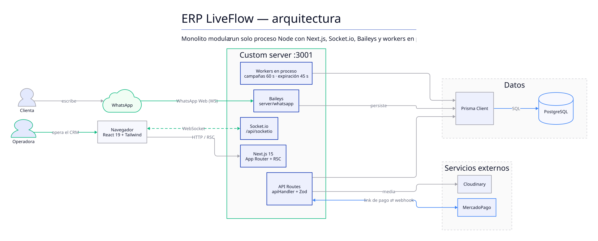
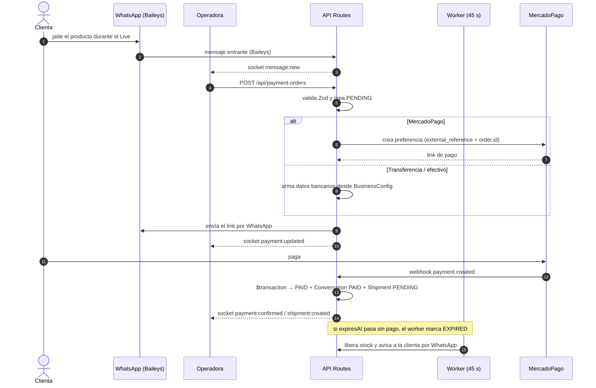
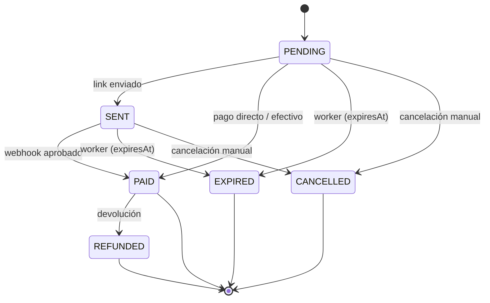

# Arquitectura — ERP LiveFlow

> Cómo está armado el sistema, capa por capa, y qué decisiones lo sostienen. Fuente de verdad para el backend.

## 1. Visión de alto nivel

Aplicación **full-stack en un solo repositorio** (monolito modular) con Next.js 15 y un **custom server** (Express/Node HTTP) que además levanta **Socket.io** y **Baileys** (WhatsApp Web). No hay microservicios.



> Fuente del diagrama: [`diagramas/arquitectura.d2`](./diagramas/arquitectura.d2). Se regenera con `npm run diagramas`; no editar el `.svg` a mano.

## 2. Capas

| Capa              | Dónde                                     | Responsabilidad                                                         |
| ----------------- | ----------------------------------------- | ----------------------------------------------------------------------- |
| UI                | `src/app/*/page.tsx`, `src/components/**` | Páginas, componentes, design system                                     |
| Hooks de datos    | `src/hooks/*`                             | Consumo de API + estado (useLeads, useShipments, useCaja, useChatPanel) |
| API routes        | `src/app/api/**/route.ts`                 | Endpoints REST, validación Zod, autorización                            |
| Lógica compartida | `src/lib/**`                              | api-handler, schemas, prisma, socket, format, audit, workers            |
| Tipos             | `src/types/index.ts`, `src/lib/enums.ts`  | Contratos compartidos cliente/servidor                                  |
| Server            | `server/**`                               | Socket.io, Baileys, schedulers                                          |
| BD                | `prisma/**`                               | Esquema, migraciones (`db push`), seed                                  |

## 3. Custom server y tiempo real

`server/index.ts` es el entry point (`npm run dev`). Hace:

1. Levanta Next con `next({ dev })`.
2. Crea un servidor HTTP propio y le acopla **Socket.io** en `/api/socketio` (CORS `*` en dev).
3. Registra handlers de socket (`server/socket/handlers.ts`).
4. Arranca **schedulers en proceso** (no hay cola externa):
   - `processScheduledCampaigns()` cada 60 s → envía campañas programadas.
   - `processExpiredPaymentOrders()` cada 45 s → expira apartados de Live y libera stock.
5. Conecta **WhatsApp** con Baileys (`connectWhatsApp(io)`). Si existe `auth_info/`, reconecta; si no, emite QR a la UI para escanear.

Flags de entorno:

- `DISABLE_WHATSAPP=true` → no conecta Baileys (útil en dev).
- `DISABLE_WORKERS=true` → apaga los schedulers.

El cliente se conecta con `useSocket()` (`src/lib/socket.ts`).

## 4. WhatsApp (Baileys)

- Librería: `@whiskeysockets/baileys` (WhatsApp Web, **sin Cloud API**).
- Estructura: `server/whatsapp/client.ts` (conexión), `server/whatsapp/bot.ts` (lógica), `server/whatsapp/handlers/messages.ts` y `media.ts`.
- La sesión se persiste en `auth_info/` (ignorado por git).
- Los mensajes entrantes actualizan `Message`/`Conversation` y se emiten por socket a la UI.

## 5. Pagos

- **MercadoPago**: `server/payments/mercadopago.ts` + webhook `src/app/api/webhooks/mercadopago/route.ts`.
- Proveedores modelados en `PaymentProvider` (MERCADOPAGO, STRIPE, PAYPAL, CASH, TRANSFER).
- `PaymentOrder` es el eje: enlaza `Conversation`, `Lead`, opcional `LiveSession` y un `Shipment` (1:1).
- Expiración automática de órdenes PENDING (worker) según `BusinessConfig.orderExpirationMinutes`.

### Flujo de una orden de cobro



### Estados de una orden



## 6. API

Patrón obligatorio: `apiHandler` + Zod.

```ts
export const POST = (req: NextRequest) =>
  apiHandler({
    body: mySchema,
    handler: async (req, body) => {
      /* ... */ return NextResponse.json(data);
    },
  });
```

- Validación de body con esquemas en `src/lib/schemas.ts`.
- Listados **paginados** server-side (patrón de `GET /api/leads`: `page`, `pageSize`, `q`, filtros, `export=1`).
- Detalle en `/[id]/route.ts` con relaciones completas.
- Errores consistentes: `{ error, details? }`.

## 7. Base de datos

- PostgreSQL + Prisma ORM. Migraciones con `npx prisma db push` (sin migraciones SQL versionadas todavía).
- Esquema en `prisma/schema.prisma` (ver `docs/domain-model.md`).
- Regla: cambios no destructivos (columnas nuevas nullable, enums solo agregan valores).

## 8. Frontend

- App Router + Server Components por defecto; componentes cliente con `"use client"` cuando hay interactividad.
- Design system en `src/components/liveflow/` (workspace, nav-rail, primitives, cuadre, hud).
- Primitivas UI en `src/components/ui/` (Radix + Base UI, utilidades en `src/lib/utils.ts`).
- Tema dark zinc + emerald vía Tailwind y `next-themes` (`src/components/theme-provider.tsx`).
- Estado de socket visible en `SocketStatus` / `AppShell`.

## 9. Configuración y entorno

- `.env` (ver `.env.example`): `DATABASE_URL`, tokens de MercadoPago, Stripe, Cloudinary, `NEXT_PUBLIC_APP_URL`, `NODE_ENV`.
- Puerto de dev: **3001**.
- Docker: `docker-compose.yml` + `Dockerfile` + `ecosystem.config.js` (PM2).

## 10. Pendientes de arquitectura (deuda conocida)

- Migraciones SQL versionadas (hoy es `db push`).
- Cola externa para workers (hoy `setInterval` en proceso; no sobrevive múltiples instancias).
- Autenticación de operadores (hoy `Operator` sin flujo de login completo).
- Multi-tenant real (`orgId` existe en `Carrier` pero no en el resto).
- Tests de integración de rutas (hoy 63 tests, mostly unit).
