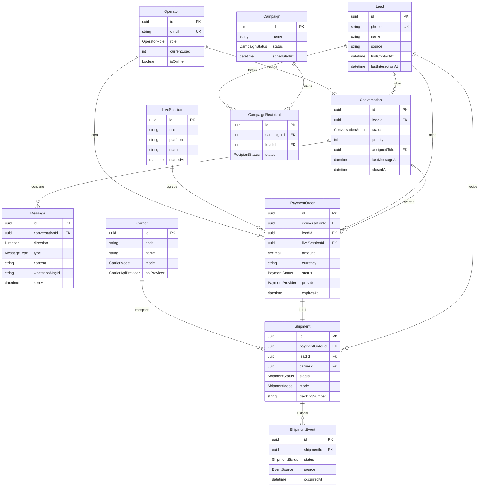
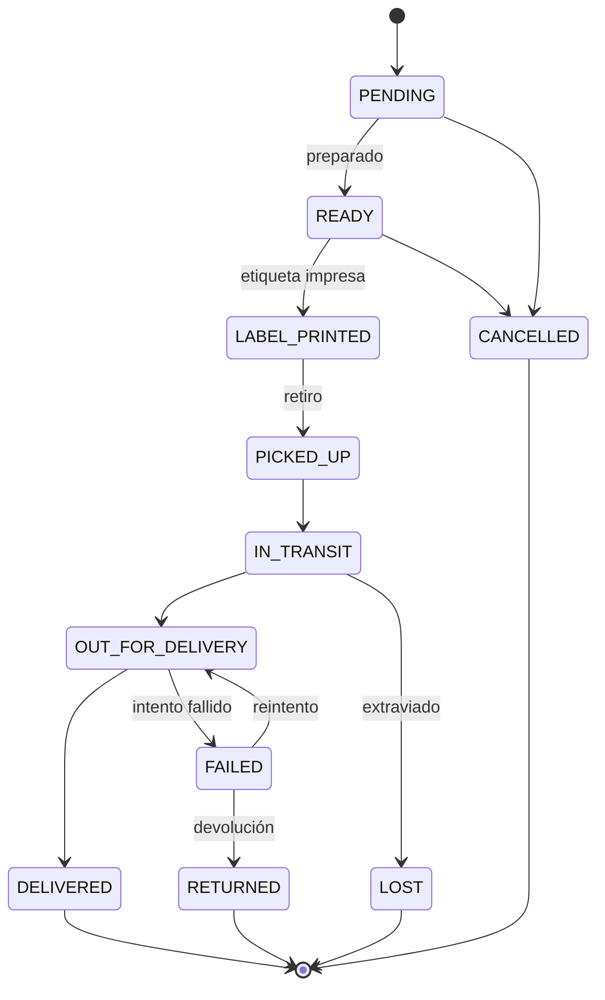

# Modelo de dominio — ERP LiveFlow

> Entidades de Prisma (`prisma/schema.prisma`). Léelo antes de tocar el esquema o escribir queries.

## Diagrama de relaciones (resumen)

Tablas sin relaciones (catálogo y configuración): `Product`, `MessageTemplate`, `BotConfig`, `BusinessConfig`, `ActivityLog`.

### Estados de un envío

Cada transición se registra en `ShipmentEvent` (`source`: `MANUAL`, `API` o `WEBHOOK`).

## Entidades

### Lead (clienta)

- `phone` único, `name`, `source`, `internalNotes`.
- Dirección desglosada (`addressStreet`, `addressNumber`, `addressColonia`, `addressCity`, `addressState`, `addressZipCode`, `addressNotes`).
- Timestamps `firstContactAt`, `lastInteractionAt`, `metadata` JSON.

### Conversation (conversación)

- Pertenece a un `Lead`; `status` = `ConversationStatus`.
- `priority`, `assignedToId` (Operator), `firstResponseAt`, `responseTimeMs`, `closedAt`.
- `ConversationStatus`: `NEW`, `ATTENTION`, `AWAITING_PAYMENT`, `PAID`, `SHIPPED`, `CLOSED`, `LOST`.

### Message

- `direction` (`INBOUND`/`OUTBOUND`), `type` (`TEXT`, `IMAGE`, `VIDEO`, `AUDIO`, `DOCUMENT`, `LOCATION`, `PAYMENT_LINK`, `SYSTEM`).
- `content`, `mediaUrl`, `whatsappMsgId`, `fromPhone`, timestamps de envío/entrega/lectura.
- `isTemplate` + `templateId` para mensajes de plantilla.

### PaymentOrder (orden de cobro)

- Monto `Decimal(10,2)` + `currency` (default `MXN`).
- Enlaza `Conversation`, `Lead`, opcional `LiveSession`, y `Shipment` (1:1).
- `status` = `PaymentStatus`: `PENDING`, `SENT`, `PAID`, `EXPIRED`, `CANCELLED`, `REFUNDED`.
- `provider` = `PaymentProvider`: `MERCADOPAGO`, `STRIPE`, `PAYPAL`, `CASH`, `TRANSFER`.
- `providerLinkId`/`providerLinkUrl` (link de pago), `expiresAt`.

### LiveSession (transmisión)

- `platform` (default `TIKTOK`), `status` (default `ACTIVE`), `startedAt`, `endedAt`, `notes`.
- Agrupa `PaymentOrder` creadas durante la transmisión.

### Operator (operador/a)

- `role` = `OperatorRole`: `ADMIN`, `AGENT`, `VIEWER`.
- `maxConversations`, `currentLoad`, `isOnline`, `lastSeenAt`.
- `passwordHash` (autenticación pendiente de completar).

### Shipment (envío)

- 1:1 con `PaymentOrder`; pertenece a `Lead`.
- `status` = `ShipmentStatus`: `PENDING`, `READY`, `LABEL_PRINTED`, `PICKED_UP`, `IN_TRANSIT`, `OUT_FOR_DELIVERY`, `DELIVERED`, `FAILED`, `RETURNED`, `LOST`, `CANCELLED`.
- `mode` = `ShipmentMode`: `COURIER`, `OWN_FLEET`, `PICKUP`.
- Logística: `trackingNumber`, `carrierId`/`carrierRef`, `service`, `weightGrams`, `dimensions`, `costClp`, `labelUrl`, `trackingUrl`, `providerRef`, `recipient`/`address` JSON, `driverId`, `attempts`, `deliveredTo`, `proofPhotoUrl`.

### ShipmentEvent (historial)

- `status`, `occurredAt`, `source` = `EventSource` (`MANUAL`/`API`/`WEBHOOK`), `note`, `payload` JSON.

### Carrier (transportista)

- `mode` = `CarrierMode`: `COURIER`, `EXTERNAL_OWN_FLEET`, `STORE_PICKUP`.
- `apiProvider` = `CarrierApiProvider`: `MANUAL`, `CHILEXPRESS`, `BLUE`, `SHIPIT`, `ENVIAME`, `STARKEN`, `CORREOS`, `SIMPLIROUTE`, `BEETRACK`.
- `orgId` + `code` únicos; configurable por cliente (sin cliente oficial).

### Campaign / CampaignRecipient

- `CampaignStatus`: `DRAFT`, `SCHEDULED`, `SENDING`, `SENT`, `CANCELLED`.
- `RecipientStatus`: `PENDING`, `SENT`, `DELIVERED`, `READ`, `FAILED`.
- Métricas: `totalLeads`, `sentCount`, `failedCount`.

### Product (catálogo)

- `name`, `price`, `currency`, `category`, `stock`, `isActive`, `isAvailable`, `imageUrl`.

### MessageTemplate

- `name`, `content`, `category`, `shortcut`, `variables`, `isActive`.

### BotConfig / BusinessConfig

- Configuración del bot (mensajes de bienvenida/ausencia/cola, horarios, delay) y del negocio (nombre, moneda, zona horaria, banco, expiración de órdenes, liberación de stock).

### ActivityLog

- Auditoría: `operatorId`, `conversationId`, `action`, `details` JSON, `createdAt`.

## Convenciones de datos

- IDs: `uuid()` (Prisma `@default(uuid())`), no cuid.
- Moneda: `Decimal(10,2)` + `currency` (soporta CLP/USD/EUR/ARS/MXN).
- Enums en **mayúsculas**; los de estado son cerrados y solo se agregan valores.
- JSON libre en `metadata`/`config`/`dimensions`/`recipient`/`address` cuando el shape es variable.

## Índices importantes

Ya definidos en el esquema para los filtros de listado más usados (status, leadId, paymentOrderId, mode, carrierId, sentAt, paidAt, etc.). Revisar `docs/herramientas.md` → Postgres antes de agregar índices.
